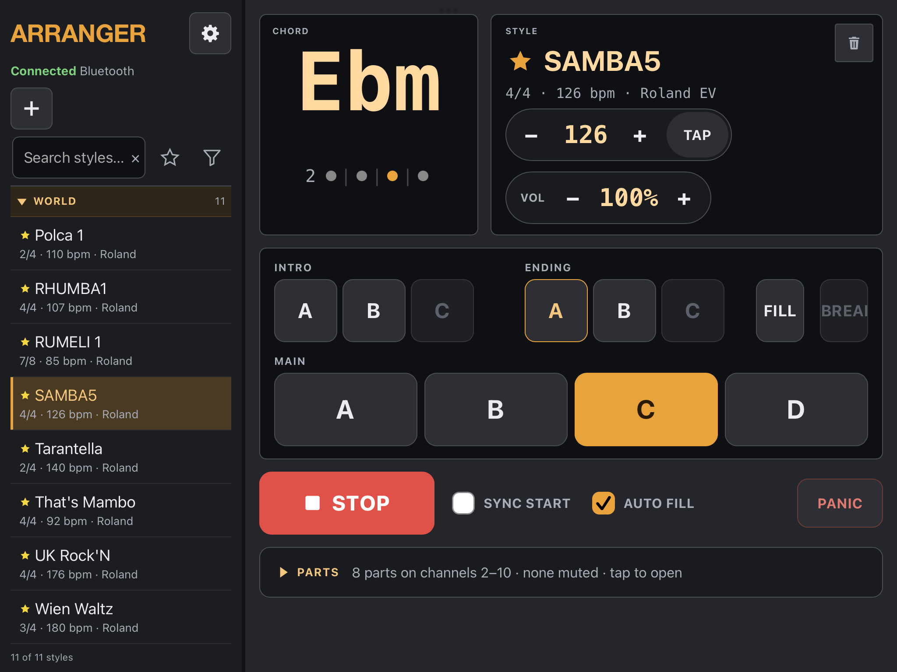

# Arranger

Live at https://pianosnake.github.io/arranger/

A Web MIDI page that plays Yamaha `.sty` and Roland `.stl` / `.sth` accompaniment styles. Connect a MIDI keyboard to this page, play chords on it, and the page plays the selected style through its built-in General MIDI synth. If that sounds really cheesy, then the page can send the parts on separate MIDI channels and you can connect your own soundfont player.

## Features

* **Learn MIDI controls:** any button (start / stop, intros, mains, fills, endings, sync start, tap tempo, tempo up / down…) can be assigned to a CC, a note or a program change from any MIDI device, so foot switches, pads and knobs can run the arranger.
* **Yamaha and Roland styles:** `.sty`, `.prs`, `.bcs`, `.sst` (SFF1 and SFF2) and Roland `.stl` / `.sth`, including odd meters like 7/8 and 9/8.
* **Chord detection** below a split point you set (or learn from a key), with chord latch, inversions and slash chords.
* **Arranger sections:** intros A–C, mains A–D, fills, break and endings A–C, changing on the next bar line, with auto fill, sync start and "chord starts style".
* **Built-in synth** with a General MIDI SoundFont, or load your own `.sf2`.
* **MIDI out:** each part on its own channel, with program changes, mute and velocity adjust per part, and the right hand sent to a channel of your choice.
* **MIDI clock out** so a looper or DAW follows along.
* **Tempo** with + / −, tap tempo, and volume, remembered for each style.
* **Style library** kept on the device: folders, search, favorites, a time signature filter, and backup / restore as a zip. Comes with 11 styles to start with.

You can download some free Yamaha styles from [here](https://www.jjazzlab.org/en/resources/).

It needs a browser with Web MIDI: desktop Chrome or Edge, Android Chrome or on the iPad / iPhone inside a [Web MIDI](https://apps.apple.com/us/app/web-midi-browser/id953846217) or [MIDI Web](https://midiweb.app/) browser app.
