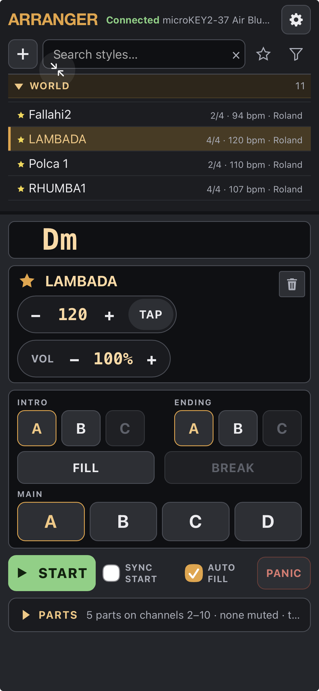

# Arranger

Live at https://pianosnake.github.io/arranger/

A Web MIDI page that plays Yamaha `.sty` and Roland `.stl` / `.sth` accompaniment styles. Connect a MIDI keyboard to this page, play chords on it, and the page plays the selected style through its built-in General MIDI synth. If that sounds really cheesy, then the page can send the parts on separate MIDI channels and you can connect your own soundfont player.

You can download some free Yamaha styles from [here](https://www.jjazzlab.org/en/resources/).

It needs a browser with Web MIDI: desktop Chrome or Edge, Android Chrome or on the iPad / iPhone inside a [Web MIDI](https://apps.apple.com/us/app/web-midi-browser/id953846217) or [MIDI Web](https://midiweb.app/) browser app.
